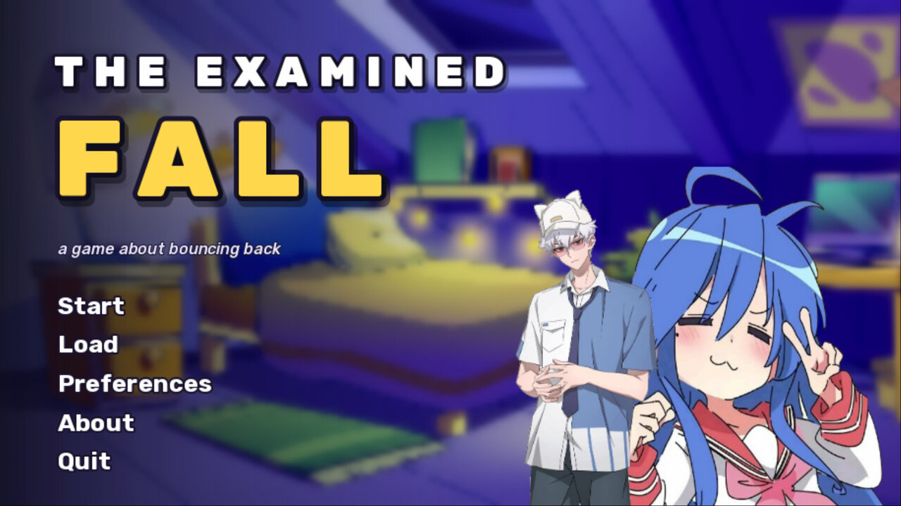

  

<h1 align="center">The Examined Fall</h1>

  a short visual novel about falling down and getting back up. 
  <b><a href="https://aarav2208.itch.io/the-examined-fall">play it on itch.io</a></b> (runs in the browser)

---

made this for a game jam. the theme was **bounce back**.

i missed registration for Haven, the hackclub event everyone was going to. i did not take that well. what i did about it was probably a bad idea.

then i met someone there who was having a much worse week than me.

that's all you get. it's short, it's dumb in places, and the people in it are my actual friends.

## screenshots

| | | |
|---|---|---|
|  |  |  |

## what's in it

- **7 philosophies** on how to bounce back, some 2000 years old, some from very dramatic 1800s guys. not all of them agree. some of them really don't
- you never find out what went wrong for him, you just pick what it feels like, so it can be whatever yours is
- you take the advice that helps and leave the rest. it remembers
- at least one guest who was not invited

acts 1 to 3 are done (around 15 min). act 4 is still being written.

## running it yourself

1. get [Ren'Py](https://www.renpy.org/latest.html) (made with 8.6)
2. add this folder as a project in the launcher
3. hit Launch Project

for the web build: launcher, then Web, then Build. if the launcher times out downloading web support, grab `renpy-<version>-web.zip` from renpy.org/dl and unzip it into the SDK folder.

## if you want to mess with it

(spoilers obviously, the whole script is in here)

- **characters:** drop one image per person into `game/pfp/` (like `oreek.png`), add the name to `CAST` in `game/sprites.rpy`. every expression (happy, shocked, sad...) gets made from that one image with an emote and a bit of motion, so you don't need to draw anything
- **backgrounds:** anything in `game/images/bg/` just works as `scene bg <filename>`
- **the story:** `game/act1.rpy`, `act2.rpy`, `act3.rpy`
- run the game once on desktop after changing images, it updates `game/image_cache.json` (the web version needs it)

## credits

- story, code, mess: Aarav
- the cast: Oreek, Shrey, DSP, Jassi, Edvance, Shwetank
- font: [Rubik](https://fonts.google.com/specimen/Rubik) (OFL)
- engine: [Ren'Py](https://www.renpy.org/)

some of the character art is people's pfps and fan art i don't own. it's placeholder and will get swapped out.
