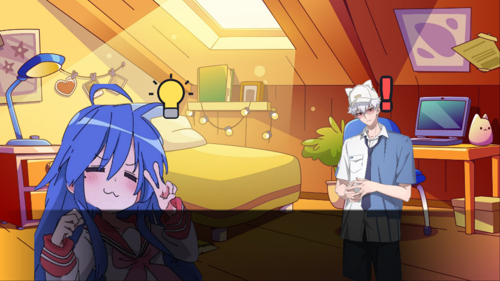
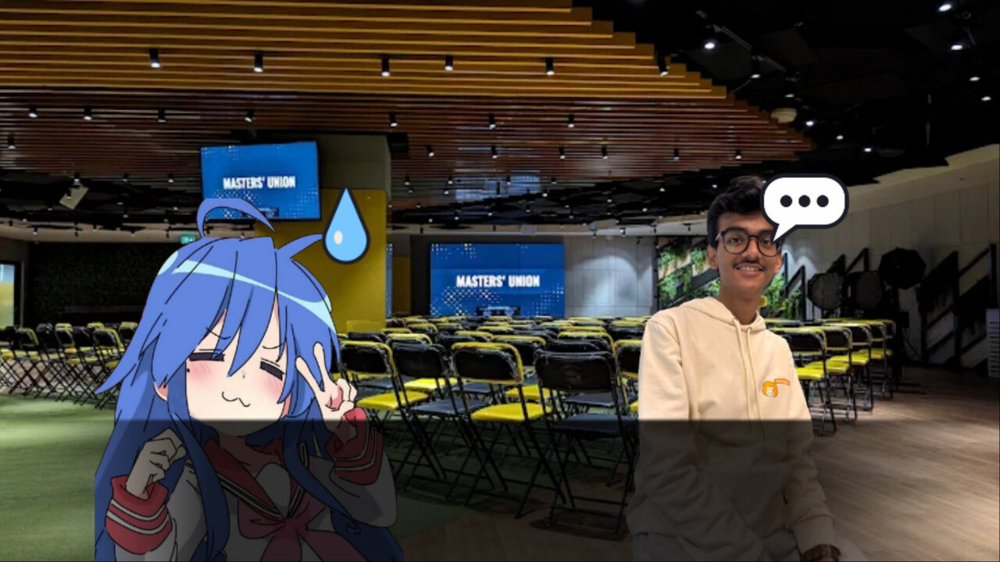
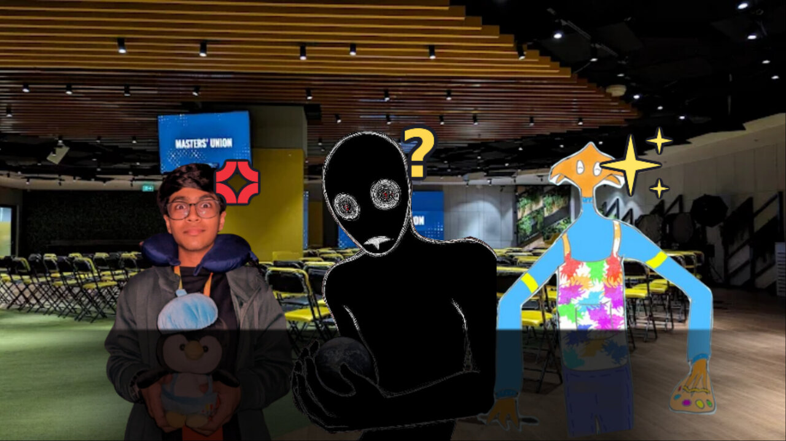

  

<h1 align="center">The Examined Fall</h1>

  i missed registration for Haven, so i went in a suitcase. 
  <b><a href="https://aarav2208.itch.io/the-examined-fall">play it on itch.io</a></b> (runs in the browser)

---

made this for a game jam. the theme was **bounce back**.

so the story goes like this. Haven Delhi registrations closed and i didn't notice (i snoozed the reminder eleven times). so i asked Oreek how big his suitcase was, got in it, and paid DSP in Five Stars and Milkybars to look the other way. those chocolates were meant for the volunteers btw. that part comes back.

once i'm in, i find this guy sitting in a corner holding the entire planet. he's not ok. so i send him around to talk to everyone, and at 3am, when everyone's running on 420mg of caffeine, some dead philosophers start showing up too.

it's short, it's dumb in places, and the people in it are my actual friends.

## screenshots

| | |
|---|---|
|  |  |
| *"is it big enough to fit a human being?"* | *"your clothes just sneezed."* |
|  |  |
| *Edvance and Shwetank fighting about stoicism* | *RENÉ DESCARTES!!* |

## the philosophy part

the guy (you play as him for most of it) hears out **7 different takes** on how to get back up after you fall:

| who | what | the idea |
|---|---|---|
| Jassi | Taoism | be like water. wait for the storm to settle, then sail |
| Edvance | Stoicism | you can't control what happened, only what you do next |
| Shwetank | Nietzsche | stop hiding from it. suffering is how you grow. CHARACTER DEVELOPMENT |
| Diogenes | Cynicism | most of what you're carrying was never yours. drop it. (he lives in the suitcase now) |
| Schopenhauer | Pessimism | everyone is suffering, so be nicer to each other. "fellow sufferer" |
| Camus | Absurdism | one must imagine Sisyphus happy. the ball always bounces back |
| Kierkegaard | Existentialism | life makes sense backwards but you live it forwards. just leap |

Descartes is also there but he doesn't really count. he gets one line.

## how it plays

- the guy's problem is never named. you just pick what it *feels* like, so it can be whatever yours is
- after each conversation you take the advice or leave it
- what you took shows up later when he talks to Aarav at 3am

acts 1 to 3 are done (around 15 min). act 4 is still being written.

## running it yourself

1. get [Ren'Py](https://www.renpy.org/latest.html) (made with 8.6)
2. add this folder as a project in the launcher
3. hit Launch Project

for the web build: launcher, then Web, then Build. if the launcher times out downloading web support, grab `renpy-<version>-web.zip` from renpy.org/dl and unzip it into the SDK folder.

## if you want to mess with it

- **characters:** drop one image per person into `game/pfp/` (like `oreek.png`), add the name to `CAST` in `game/sprites.rpy`. every expression (happy, shocked, sad...) gets made from that one image with an emote and a bit of motion, so you don't need to draw anything
- **backgrounds:** anything in `game/images/bg/` just works as `scene bg <filename>`
- **the story:** `game/act1.rpy`, `act2.rpy`, `act3.rpy`
- run the game once on desktop after changing images, it updates `game/image_cache.json` (the web version needs it)

## credits

- story, code, mess: Aarav
- the cast: Oreek, Shrey, DSP, Jassi, Edvance, Shwetank
- font: [Rubik](https://fonts.google.com/specimen/Rubik) (OFL)
- engine: [Ren'Py](https://www.renpy.org/)

some of the character art is people's pfps and fan art i don't own. it's placeholder and will get swapped out.
