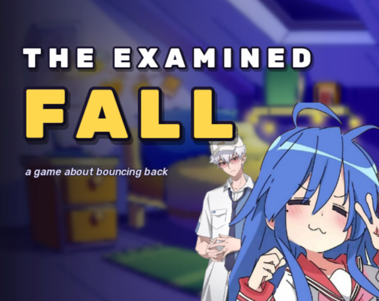
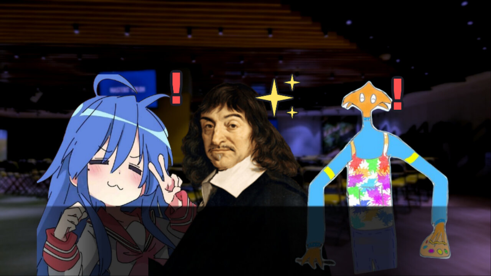

  

<h1 align="center">The Examined Fall</h1>

  i missed registration for Haven, so i went in a suitcase. 
  <b><a href="https://aarav2208.itch.io/the-examined-fall">play it on itch.io</a></b> (runs in the browser)

---

made this for a game jam. the theme was **bounce back**.

it's short, it's dumb in places, and the people in it are my actual friends.

## screenshots

| | |
|---|---|
|  |  |
| *"is it big enough to fit a human being?"* | *"your clothes just sneezed."* |
|  |  |
| *Edvance and Shwetank fighting about stoicism* | *RENÉ DESCARTES!!* |

## the philosophy part

the guy (you play as him for most of it) hears out **7 different takes** on how to get back up after you fall:

| who | what | the idea |
|---|---|---|
| Jassi | Taoism | be like water |
| Edvance | Stoicism | control what you can |
| Shwetank | Nietzsche | CHARACTER DEVELOPMENT |
| Diogenes | Cynicism | drop what isn't yours |
| Schopenhauer | Pessimism | fellow sufferer |
| Camus | Absurdism | imagine Sisyphus happy |
| Kierkegaard | Existentialism | just leap |

Descartes is also there but he doesn't really count. he gets one line.

## how it plays

- the guy's problem is never named. you just pick what it *feels* like, so it can be whatever yours is
- after each conversation you take the advice or leave it
- what you took shows up later when he talks to Aarav at 3am

acts 1 to 3 are done (around 15 min). act 4 is still being written.

## running it yourself

1. get [Ren'Py](https://www.renpy.org/latest.html) (made with 8.6)
2. add this folder as a project in the launcher
3. hit Launch Project

for the web build: launcher, then Web, then Build. if the launcher times out downloading web support, grab `renpy-<version>-web.zip` from renpy.org/dl and unzip it into the SDK folder.

## if you want to mess with it

- **characters:** drop one image per person into `game/pfp/` (like `oreek.png`), add the name to `CAST` in `game/sprites.rpy`. every expression (happy, shocked, sad...) gets made from that one image with an emote and a bit of motion, so you don't need to draw anything
- **backgrounds:** anything in `game/images/bg/` just works as `scene bg <filename>`
- **the story:** `game/act1.rpy`, `act2.rpy`, `act3.rpy`
- run the game once on desktop after changing images, it updates `game/image_cache.json` (the web version needs it)

## credits

- story, code, mess: Aarav
- the cast: Oreek, Shrey, DSP, Jassi, Edvance, Shwetank
- font: [Rubik](https://fonts.google.com/specimen/Rubik) (OFL)
- engine: [Ren'Py](https://www.renpy.org/)

some of the character art is people's pfps and fan art i don't own. it's placeholder and will get swapped out.
